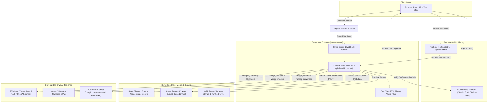

# Hivemind SaaS — Serverless Architecture

## System Architecture (`europe-west4`)

## Key Design Decisions
- **Scale-to-Zero Cost Optimization**: Cloud Run (`min_instance_count = 0`), Firestore Native, Firebase Hosting, and GCP Identity Platform (free up to 50,000 MAU) keep idle infrastructure cost near **\$0/month** on GCP.
- **Pre-Flight Moderation**: All user inputs (chat, scenes, character cards, worlds/lore) are scanned against admin-managed trigger words **before** any LLM or GPU API call is made.
- **Configurable Image Pipeline**: `InferenceConfig.image_provider` supports `vertex_imagen`, `runpod_serverless`, `comfyui`, `mps_diffusers`, and `procedural_art` without changing application code.
